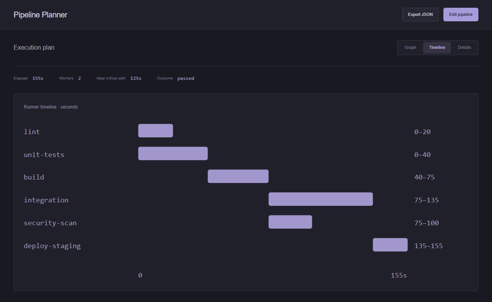

# Pipeline Planner

Simulate dependency graphs, worker limits, retries, queue time, and critical paths.



## Run

Requires Python 3.11+; no third-party runtime dependencies. Clone this repository and run from its root:

```sh
python run.py
```

Open http://127.0.0.1:8000/. Use `python run.py --port 8001` to run alongside another app.
The app initially simulates a built-in fictional pipeline. Open **Edit pipeline** to change its JSON or load another file.

The local adapter creates an empty `data/pipeline-planner.db`; this analysis app has no persistent tables. The data directory is ignored by Git. `--database /path/to/app.db` selects another database. Uploaded analysis input is processed in memory. No other repository or shared service is required.

## Interface

The main view is a dependency graph arranged by dependency depth. Select a job with the pointer or Enter/Space to inspect its status, schedule, attempts, and dependencies. Graph, Timeline, and Details views share the same simulation; Details retains capacity comparisons and queue/retry timing. Pipeline JSON and worker count live in a dialog that closes after a successful run. Invalid input keeps the editor open and disables exports. Wide graphs and tables scroll within their panels on mobile.

The request lifecycle still supports cancellation, timeout handling, and input-preserving errors. No pipeline commands are executed.

## API example

`examples/request.json` contains a fictional request body and its endpoint. Browser analysis requests use `Content-Type: application/json` and `X-Portfolio-Client: browser`; Notes requests use `X-API-Key`. All routes are local to this app.

## Architecture

The browser uses plain JavaScript and CSS, a loopback Python HTTP server validates requests, and domain functions produce the reports or transactional writes. `portfolio/` is the retained internal Python package name; this repository serves only **Pipeline Planner**. Its database contains only this app's tables. Shared validation, CSV helpers, and visual utilities have local copies, so changes can be released independently.

## Verify

```sh
python -m unittest discover -s tests -v
python check_js.py
node --test
```

Node.js 22+ is used for frontend checks only. GitHub Actions tests Linux on Python 3.11–3.13 and Windows on Python 3.13.

## Scope

Designed as a local portfolio/demo application. The standard-library server is not a production internet deployment. There is no multi-user authentication or tenant isolation.

## Source provenance

Extracted from [Portfolio Lab](https://github.com/Michaelhoang8/portfolio-lab) at commit `ce14f2cf297c6dfbd5895b9138626b7e69530ec0`. The original repository retains the genuine development history. This repository begins with the standalone extraction; history has not been backdated. Runtime databases and credentials were not copied.
